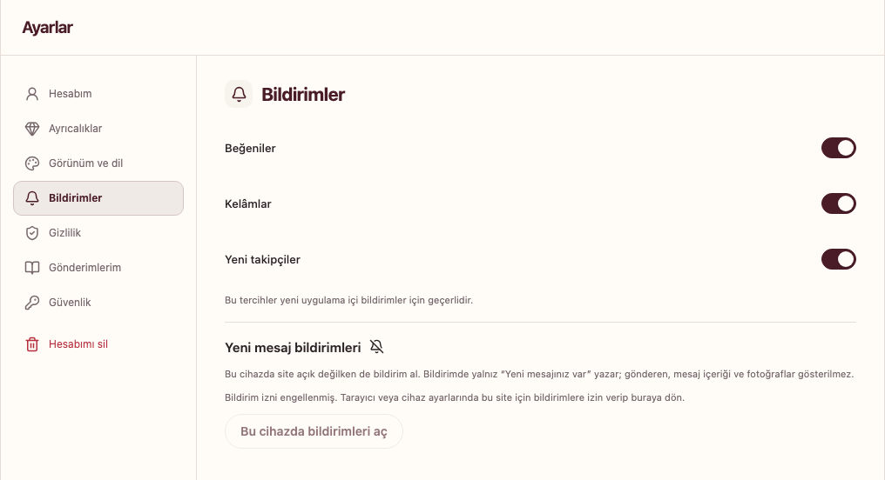

# Bildirimler

Uygulama içindeki **Bildirimler** bölümünden hesabınızla ilgili etkinlikleri görebilirsiniz. **Ayarlar → Bildirimler** alanındaki beğeni, yanıt ve takip tercihlerini ayrı ayrı yönetin.

*Gerçek yerel ekran, 6 Kasım 2026. Bu çekimde tarayıcının bildirim izni engellenmiş durumdadır; kendi cihazınızdaki izin durumu farklı olabilir.*

## Yeni mesajları bu cihazda alma

1. Uygun bir tarayıcıda Ukte’ye giriş yapın.
2. **Ayarlar → Bildirimler → Yeni mesaj bildirimleri** bölümünü açın.
3. **Bu cihazda bildirimleri aç** düğmesine basın.
4. Tarayıcının izin sorusunu onaylayın.

Girişten sonra gösterilen **Yeni mesajları kaçırma** kartından da aynı işlemi başlatabilirsiniz. **Şimdi değil** seçeneğiyle kartı erteleyebilirsiniz. Cihaz bildirimi izni her tarayıcı ve cihazda ayrı yönetilir.

## Mahrem bildirim içeriği

Yeni mesaj cihaz bildirimi genel bir uyarı kullanır; gönderen adı, mesaj metni veya medya ön izlemesi göstermez. Mesajı okumak için Ukte’de ilgili sohbeti açın.

## iPhone ve iPad

Desteklenen iOS/iPadOS sürümlerinde önce Safari’den Ukte’yi **Ana Ekrana Ekle** ile kurmanız gerekebilir. Siteyi ana ekran simgesinden açıp bildirim ayarına dönün. Uygulamanın gösterdiği kurulum açıklamasını izleyin.

## Bildirim gelmiyorsa

Tarayıcıdaki site iznini, işletim sisteminin bildirim iznini, odak/rahatsız etme ayarlarını ve sohbetin sessize alınıp alınmadığını kontrol edin. Cihaz bildirimleri desteklenen güvenli bağlantı ve tarayıcı koşullarını gerektirir.

Sekmeyi kapatmak ile tarayıcıdan tamamen çıkmak farklıdır. Teslimat; tarayıcı, işletim sistemi ve bağlantı durumuna bağlıdır, her durumda anında ulaşmayabilir.

## Kapatma

Aynı ayarlar bölümünden bu cihazdaki mesaj bildirimlerini kapatabilirsiniz. Oturumdan çıkış da ilgili oturumun bildirim kaydını kaldırır. İşletim sistemine zaten ulaşmış bir uyarı geri alınamayabilir.
