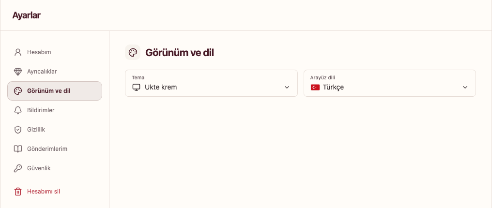

# Dil ve görünüm

**Ayarlar → Görünüm ve dil** bölümünü açın. Arayüz dilini ve temanızı buradan değiştirebilirsiniz.

*Yerel Ukte sitesinin gerçek ayar ekranı, 6 Kasım 2026.*

## Arayüz dili

Ukte Türkçe, İngilizce ve Arapça arayüz sunar. Arapça seçiminde sayfa düzeni sağdan sola uyarlanır. Giriş yapmadan önce de sayfada sunulan dil seçiciyi kullanabilirsiniz.

Arayüz dilini değiştirmek, başka üyelerin yazdığı gönderileri veya özel mesajları otomatik olarak çevirmez. Profilinizde konuştuğunuz dilleri belirtmek de arayüz dilinden ayrı bir seçimdir.

## Tema

**Ukte krem**, **Açık** ve **Koyu** seçeneklerinden size uygun olanı seçin. Tema tercihi görünümü değiştirir; profil, fotoğraf ve gönderilerinizin erişim izinlerini değiştirmez.

## Telefonda kullanım

Dar ekranda gezinme alanları ve menüler farklı konumda görünebilir. Ekrandaki geri düğmesini veya tarayıcınızın geri hareketini kullanabilirsiniz. İçerik yazıyorsanız sayfadan ayrılmadan önce gönderme ya da kaydetme işleminin tamamlandığından emin olun.
