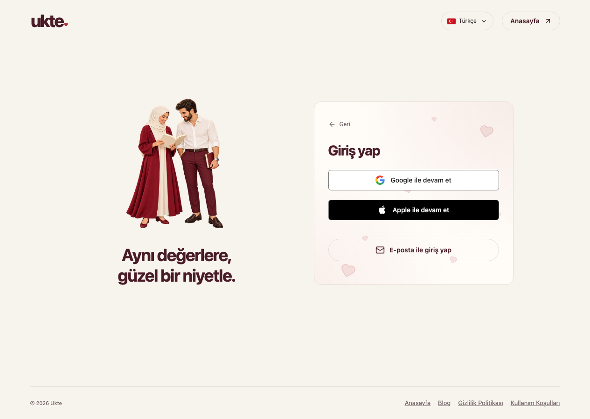
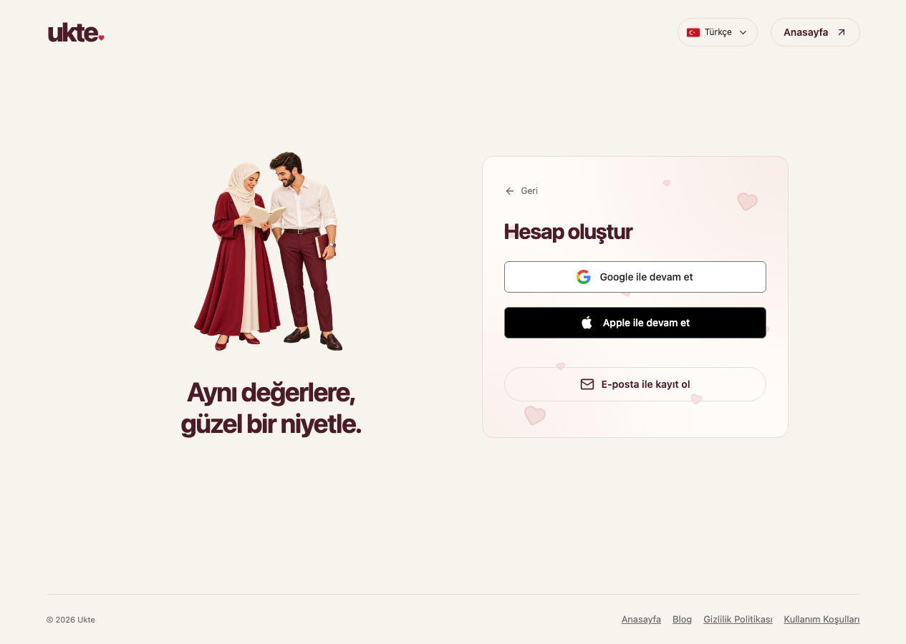

# Üyelik ve giriş

*6 Kasım 2026’da yerel Ukte sitesinden alınmış gerçek giriş ekranı. Sağlayıcı düğmeleri sitede etkin olduklarında görünür.*

## Kayıt olma

1. Ukte’nin kayıt sayfasında **Hesap oluştur** ekranını açın.
2. **E-posta ile kayıt ol** seçeneğiyle formda istenen bilgileri doldurun; sunuluyorsa Google veya Apple yöntemini seçebilirsiniz.
3. Formdaki parola koşullarını karşılayın ve kaydı gönderin.
4. İsteniyorsa e-posta doğrulamasını tamamlayın.
5. Profilinizi doldurarak devam edin.

*Gerçek kayıt ekranı; yerel Ukte ortamı, 6 Kasım 2026.*

Ziyaretçi olarak bir gönderi yazmaya veya başka bir üye eylemine başlamışsanız uygulama, girişten sonra sizi ilgili akışa döndürebilir. İşlemin tamamlandığını görmeden aynı içeriği tekrar göndermeyin.

## E-posta doğrulama

Gelen kutunuzu ve istenmeyen posta klasörünü kontrol edin. Doğrulama bağlantısını açtıktan sonra uygulamaya dönün. Gerekirse **Ayarlar** bölümündeki doğrulama durumunu kontrol edin veya yeni e-posta isteyin.

E-posta hizmeti geçici olarak kullanılamıyorsa doğrulama ya da sıfırlama gönderilemeyebilir. Bu durumda ekrandaki hata açıklamasını esas alın; [sorun giderme](../yardim/sorun-giderme.md) bölümüne bakın.

## Google veya Apple ile giriş

Bu düğmeler görünüyorsa kullanmak istediğiniz sağlayıcıyı seçin ve sağlayıcının ekranındaki adımları tamamlayın. Dönüşte profil veya e-posta adımı istenirse onu da tamamlayın.

Her seferinde hesabınızı açtığınız yöntemle giriş yapmaya dikkat edin. Giriş sağlayıcınızın parolasını Ukte’deki mesaj veya destek alanlarına yazmayın.

## E-posta ile giriş

**Giriş yap → E-posta ile giriş yap** seçeneğini açın. E-posta ve şifre alanlarını doldurup **Giriş yap** düğmesine basın. Kayıt yönteminiz Google veya Apple ise ilgili sağlayıcının düğmesini kullanın.

## Şifremi unuttum

E-posta giriş formunda **Şifremi unuttum** seçeneğini açın ve hesabınızın e-posta adresini girin. Gelen sıfırlama bağlantısında yeni parolanızı belirleyin. Eski veya süresi dolmuş bağlantı yerine yeni bir sıfırlama isteği oluşturun.

## Ücretsiz kullanım ve paketler

Kayıt olmak ile Gold/VIP satın almak ayrı işlemlerdir. Ücretsiz erkek hesabında günlük 30 mesaj hakkı, kadın hesabında ücretsiz sınırsız mesajlaşma bulunur. Paket hakları ve gerçek seçim ekranları için [üyelik karşılaştırmasına](../uyelik/README.md) bakın.

## Oturumdan çıkma

**Ayarlar** bölümünden mevcut oturumunuzu kapatabilirsiniz. Başka cihazlarda açık oturumlarınız varsa tüm oturumları kapatma seçeneğini kullanın. Ayrıntılar: [Hesap güvenliği](../guvenlik/hesap-guvenligi.md).
